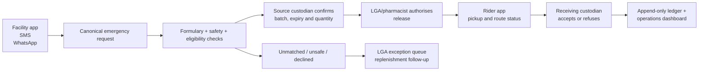

# Supplai Product Recovery Plan

**Version:** 1.0  
**Prepared:** 3 November 2026  
**Target:** GBSN Social Logistics Challenge, Health and Humanitarian Supply Chains  
**Submission deadline shown by GBSN:** 15 November 2026  
**Working mode:** prototype with clearly labelled fictional data, backed by human-led local validation
**Supporting evidence:** [GBSN challenge evidence brief](references/gbsn-challenge-evidence.md)

## The decision

Build **Supplai as an LGA-authorised emergency medicine-response control tower**, not as an SMS stock marketplace.

The primary product is one Expo Android application with two role-specific mobile experiences, plus a web operations console:

1. **Facility app** for a PHC custodian to raise, confirm, and receive an urgent exception order.
2. **Operations web console** for an LGA/pharmacist to see, authorise, and resolve exceptions.
3. **Rider app** for pickup, in-transit tracking, and documented handover.

The facility and rider flows live in the same role-based Expo project to protect time and budget. SMS and WhatsApp are secondary entry and notification channels. A message creates the same canonical order as the native app, and the complete state appears when the user next opens the app or web console. This is the right analogy: a request can start in a low-connectivity channel, but the system of record and visible experience live in the product.

## The non-negotiable eligibility gate

There is a material conflict to resolve immediately. The live GBSN page says entrants should **not** use generative AI to develop, write, analyse, or substantially modify their submission, and says undisclosed or inappropriate use can affect eligibility. It also requires a written report plus a creative illustration, approximately three minutes or an equivalent non-video format. [GBSN, *The Social Logistics Challenge*](https://gbsn.org/slc/)

Your statement that AI has been allowed may reflect a written organiser clarification, but the public rules currently say the opposite. The fact that the idea is human-led does not, by itself, resolve that conflict.
**Farid's first task is to preserve the organiser's confirmation from the live meeting and follow the required AI-crediting guidance before submission.** The organiser confirmed that AI-assisted material may be used, provided the AI used to generate the report is credited appropriately. Until the exact credit wording is recorded:

- Treat this file, generated code suggestions, and AI-produced wording as working material that must still be reviewed and verified by the team.
- Recreate and verify all contest-facing analysis, prose, visuals, and claims yourselves from your own notes and sources.
- Keep a dated human research log, interview notes, source register, sketches, design decisions, and Git history.
- Credit any AI used to generate the report according to the organiser's instructions.
- Do not claim a live pilot, partner, legal approval, or delivery integration unless it is real and documented.

This is a protection for the team, not a reason to slow down the prototype.

## Why Supplai can win

GBSN asks teams to keep the logistics system at the centre, identify a local community and stakeholders, give an actionable business solution, measure intended outcomes, state their biggest assumption, and communicate it creatively. [GBSN, *The Social Logistics Challenge*](https://gbsn.org/slc/)

The 2025 winner, HemoMesh VN, was not merely an inventory interface. It connected fragmented actors around a precise health-supply problem, combining stock balancing with end-to-end quality controls, expiry control, transport quality, and a human operating model. [GBSN, *Winners of the 2025 Social Logistics Challenge*](https://gbsn.org/winners-of-the-2025-gbsn-social-logistics-challenge/)

Supplai's winning distinction is therefore not “we send medicine by SMS.” It is:

> **When a public PHC has an urgent stockout, Supplai turns a fragmented, phone-call-based scramble into one authorised, traceable exception workflow that protects the donor facility and makes unresolved demand visible to the LGA.**

That means the product needs to prove five things in one memorable flow:

1. A real exception is raised quickly, whether from the app, SMS, or WhatsApp.
2. The supplying facility, not the requester, confirms that stock is physically available and safe to release.
3. An LGA/pharmacist authorises the movement, with safety stock, product restriction, batch, and expiry checks visible.
4. A rider completes a two-sided, auditable handover.
5. A failed or unmatched request becomes an LGA replenishment exception, not a silent dead end.

## Honest critique of the current repository

The foundation is good. The product surface and real-world operating model are not yet complete.

| Area | What exists now | What must change before the creative illustration |
| --- | --- | --- |
| API and database | Fastify, Supabase schema, typed contracts, SMS normalisation, request/match/reservation flow, mock dispatch, delivery proof, append-only movement ledger, tests | Keep this as the system core and evolve it rather than rebuilding it. |
| Web and mobile UX | A dashboard workspace with a README and a contract example, but no operations screen, Expo app, routing, or visual system | Build the Expo facility/rider and React operations experiences now. Judges must be able to see and understand the system without reading code. |
| Product position | The repository describes Supplai as SMS-first medicine stock coordination | Reposition it as LGA-authorised emergency exception management. Messaging becomes a bridge into the workflow. |
| Clinical and regulatory safety | Current records model medicine and quantity, but not batch, expiry, condition, safety stock, programme restrictions, authorised people, source pickup proof, refusal, recall, or quarantine paths | Add only the minimum fields and states needed to show a responsible ambient-medicine pilot. Do not portray a demo as approval to move real stock. |
| Delivery | `MockDispatchAdapter` and demo endpoints provide a valid simulation seam | Integrate a rider UI and simulated live tracking. Label the carrier connection as simulated unless a real partner is integrated and verified. |
| Evidence | Fictional seed data is appropriate for a demo but cannot prove impact | Farid must assemble human-led local evidence and clearly distinguish evidence, assumptions, and simulated data. |
| Security | Supabase RLS is closed to browser users and the server handles privileged access | Replace visible four-digit proof-only UX with authenticated role actions plus a short-lived one-time code. Rate-limit demo endpoints before deployment. |

The current architecture is not wasted work. It is the transaction engine beneath the product we now need to make visible.

## Review reconciliation: what the Claude review changes

The review is useful, but not every point is new or equally evidenced. The table below is the team decision record.

| Review point | Status after direct review | Plan action |
| --- | --- | --- |
| Essential-medicine availability is low and the Health track fit is exact | The [National Bureau of Statistics' 2023 National Health Facility Survey](https://microdata.nigerianstat.gov.ng/index.php/catalog/149/related-materials) exists and includes an essential-drug availability section. The 36.2% figure appears in legacy Supplai materials, but Farid must verify its exact table/page before it is used in the report or deck. | Use the NBS report as a source lead, not a slide statistic until the precise citation is captured. |
| Confirm-before-dispatch is the core differentiator | Correct. It is the strongest mechanics-first idea in the product. | Keep it central, but change the interaction from a bare Y/N response into a source-custodian shelf, batch, expiry, and safety-floor confirmation. |
| The code may allow the requester, rather than the supplier, to confirm | **Verified.** The in-memory repository checks `offer.phone`, which is the requester; the deployed SQL function joins the request facility against `p_phone`. Neither verifies that the source facility answered. | Make source-custodian authority the first backend correction. Add a regression test proving a requester cannot confirm or reserve supplier stock. |
| No named local community, facility interview, pharmacist, or stock audit | Correct and not solved by a polished prototype. | Farid owns one no-cost validation sprint: a call/interview with an LGA health officer, pharmacist, or two PHC staff, with consented notes. The product remains clearly simulated unless evidence permits a narrower claim. |
| Regulatory design is the central real-world gap | Correct. NAFDAC GSDP is already a foundation of this plan; the review usefully adds a sharper governance, risk, and compliance framing. | Add a simple GRC matrix covering authority, batch/expiry traceability, handover, exceptions, privacy, and incident ownership. Do not claim that the prototype is regulator-approved. |
| Oxytocin contradicts the no-cold-chain scope | Correct. The development brief already excludes it, but the old deck and HTML still contain oxytocin examples. | Keep only ambient-stable tracer commodities in the demo. Do not use legacy deck assets until oxytocin, receiver-confirm wording, unvalidated pricing, and 20–30-clinic claims are removed. |
| Donor protection, FEFO, batch/expiry, and recall matter | Already identified in the recovery plan and now elevated to the first data-model work. | Implement safety stock, batch/expiry capture, FEFO ranking, receiving check, exception status, and a recall-search demonstration before visual polish. |
| Economics and rider incentives need work | Correct. Existing deck pricing and per-drop claims are not validated. | Use a transparent scenario worksheet with variables, not invented prices or subscriptions. A future pilot pays a carrier for a documented compliant handover, not raw delivery volume. |
| One major assumption and a fallback are necessary | Already identified, and the review confirms its importance. | State that usable, authorised nearby surplus is the core assumption. If unsupported, Supplai becomes an LGA stockout-visibility and escalation tool with no peer transfer. |

### Legacy deck replacement

The existing deck, generated HTML, and old narrative are **not** submission material. They are being replaced, not merely quarantined. Their oxytocin example, SMS-first positioning, receiver-confirmation description, unverified statistics/prices, and 20–30-clinic pilot claim must not survive into the rebuilt story.

- **Farid** owns the claim register, source checks, local-validation wording, and final narrative approval.
- **You** own the authoritative product workflow represented in the deck: source-custodian confirmation, authority release, rider handover, receipt, and the Scenario Lab data states.
- **Akolo** owns the operations-console visual evidence and the web sequence used in the creative illustration.
- The new story is: **LGA-authorised emergency exception control for ambient tracer commodities**, demonstrated through explicitly fictional but operationally credible scenarios. The mobile app and operations console are primary; SMS/WhatsApp are optional intake bridges.

## Product boundary: one narrow, credible pilot

### Pilot story

Use one named LGA only after Farid has verified it. Until then, use **“Aiyetoro Demo LGA, fictional data”** everywhere in the prototype and do not imply that it is a partner site.

| Item | Controlled MVP scope |
| --- | --- |
| Facilities | 6–8 public PHCs plus one LGA store; no private marketplace |
| Commodities | Two locally validated, ambient-stable tracer commodities. ORS and zinc remain the development defaults until a pharmacist validates alternatives. |
| Service | Authorised emergency exception response during a defined operating window |
| Geography | One LGA, fictional map coordinates and routes until permission exists |
| Users | Facility requester/custodian, source custodian, LGA/pharmacist, rider, receiving custodian |
| Data | No patient data. Fictional staff, facilities, inventory, rider, and route data in the public demo. |
| Integration | Supabase is real; SMS and WhatsApp can be simulated or sandboxed; dispatch tracking is simulated unless a qualified carrier is available. |

### What we deliberately do not build

- A national LMIS replacement
- Open public medicine listings or direct patient ordering
- Payments, procurement, or commercial pricing screens
- Cold-chain, controlled medicines, vaccines, or high-risk products
- Real medicine movement without written authority, product-quality procedures, and a trained carrier
- A generic AI chatbot or “AI matching” claim
- A full provider-grade WhatsApp production onboarding journey

This discipline is a strength. Nigeria's NAFDAC distribution guidance makes traceability, authorised recipients, valid delivery orders, batch/expiry records, transport conditions, and dispatch documentation central to pharmaceutical distribution. [NAFDAC, *Good Storage and Distribution Practices Guidelines for Pharmaceutical Products*, 2024](https://www.nafdac.gov.ng/wp-content/uploads/Files/Resources/Guidelines/PMS_Guidelines_2024/NAFDAC-Good-Storage-and-Distribution-Practice-Guidelines-For-Pharmaceutical-Products-1.pdf)

## The end-to-end product flow



### Canonical order lifecycle

Use one canonical `emergency_request` regardless of origin. Each inbound channel produces an `InboundIntent`, which is parsed and attached to an order. The interface, messages, and operational console display the same reference and state.

1. **Request created**: a facility selects a controlled formulary item, quantity, urgency reason, and optional note. SMS and WhatsApp send the same request through an adapter.
2. **Safety check**: the system assesses formulary, source safety stock, available stock, product restriction, expiry threshold, service hours, route availability, and role authority.
3. **Sequential source offer**: one eligible source custodian receives a clear offer. It is never a broadcast promise.
4. **Source confirmation**: the source custodian confirms actual shelf stock, batch, expiry, pack size, condition, and releasable quantity. A decline or timeout releases the offer and advances the queue.
5. **LGA release**: an LGA/pharmacist sees the audit strip and approves, rejects, or escalates. In the visual demo this should take one obvious action.
6. **Rider pickup**: the source confirms collection with a short-lived release code or signed action. The rider cannot create or approve their own delivery.
7. **In transit**: the rider app shows a focused route, next destination, package reference, handling note, and live status. No patient details.
8. **Receiving and exception handling**: the destination checks quantity, condition, batch, expiry, and seal. It accepts or refuses. A refusal creates a visible incident, not a silent completion.
9. **Close or escalate**: an accepted handover writes two movements and updates the facility stock. An unmatched, declined, unsafe, failed, or expired request becomes an owned LGA exception.

## The primary experiences

### 1. Facility app, mobile-first Expo experience

This is the emotional centre of the demo. It should feel fast, calm, and trustworthy, not like a form-heavy government portal.

**Core screens**

1. **Home / stock health**: a compact greeting, facility status, at-risk tracer commodities, active request card, and one large “Request emergency fill” action.
2. **Create request**: searchable controlled formulary, pack quantity, urgency reason, optional note, and a clear explanation of what happens next.
3. **Request timeline**: a living timeline from created to source-confirmed to rider-assigned to received. It displays the transfer reference and ETA, with channel updates collected in the same feed.
4. **Incoming source offer**: one decision card showing requested medicine, requested quantity, safety floor after release, required batch/expiry information, and confirm/decline actions.
5. **Receive handover**: a visually deliberate verification checklist, not just a PIN field. The user can accept or refuse and record the reason.
6. **Request history**: a clean audit list with status chips and a clear “Escalated to LGA” state.

**Interaction principles**

- One primary action per screen.
- All progress is visible through a vertical transfer timeline.
- Use clear language: “Needs review”, “Awaiting source confirmation”, “Rider en route”, “Received”, and “Escalated”.
- Build the facility and rider experiences in **React Native with Expo**, sharing the existing Fastify/Supabase backend and typed contracts. Use an Expo Android build for the app-like demonstration; keep the operations console as a responsive web application.
- Use one Expo project with role-based demo accounts rather than two separately deployed mobile applications. It produces the right role experience without duplicating build, release, or testing effort.

### 2. LGA operations console, web-first

The console must make a judge understand the operational value in ten seconds. It should look like a focused command centre, not a generic admin dashboard.

**Home layout**

- Top rail: active exceptions, awaiting source confirmation, awaiting LGA release, riders in transit, and unresolved requests.
- Main left: an LGA map or stylised geographic network with active route arcs and facility status dots. Use fictional geography until field permission exists.
- Main right: a priority stack. The next operational decision is always at the top.
- Bottom: a live transfer feed with timestamps and an impact strip: average time to source confirmation, matched request rate, successful handovers, unresolved exceptions.

**Essential views**

1. **Exception queue**: primary operator view for unmatched, expired, rejected, delayed, or unsafe requests. Every exception has a named next owner and an escalation route.
2. **Release review drawer**: shows source safety stock, batch, expiry, destination, rider, and audit requirements together before approval.
3. **Transfer detail**: exact status timeline, handover evidence, incident timeline, and ledger entries.
4. **Facility network**: stock health for the two tracer commodities, response behaviour, and facilities needing stock reconciliation.
5. **Audit export**: a constrained CSV/download state showing this is a compliance-aware operating tool, not just a pretty dashboard.

### 3. Rider app, mobile-first Expo experience

The rider has one job at a time. This must never become a dense operations dashboard.

**Core screens**

1. **Assigned job**: pickup and destination cards, medicine category, package reference, route preview, handling condition, and call buttons.
2. **Pickup confirmation**: source release code/signature, package condition check, and “Start journey”.
3. **In-transit route**: a clean animated route line, elapsed time, destination, and an incident action.
4. **Handover**: “Arrived” action followed by receiver-controlled acceptance. The rider cannot self-complete delivery.

### 4. SMS and WhatsApp, secondary but real in the story

Do not use SMS/WhatsApp as the showcase surface. Use them as resilient access points.

| Channel | Demo purpose | MVP implementation |
| --- | --- | --- |
| SMS | Low-data fallback and notification | Existing provider-neutral webhook boundary plus a simulator. Use a controlled message grammar and link every message to an order reference. |
| WhatsApp | Familiar rich notification and quick request entry | Add an adapter and an in-product conversation simulator first. Use a provider sandbox only if it is genuinely free and does not delay the build. |
| Expo app + web console | Primary experience and system of record | Role-based facility and rider flows in Expo; role-based LGA operations console in React web, all against the Fastify API. |

WhatsApp is sensible as an add-on, but provider onboarding must not block the build. The default is an in-product simulator with clearly labelled fictional message events. A sandbox is optional, never a presentation dependency. Twilio's official sandbox supports testing before sender registration, while production requires business-account and sender onboarding. [Twilio, *Quickstart: Send and receive WhatsApp messages*](https://www.twilio.com/docs/whatsapp/quickstart) [Twilio, *WhatsApp Business Platform overview*](https://www.twilio.com/docs/whatsapp/api)

## Data, safety, and interface changes

### Required model evolution

Keep the current ledger and request core. Add the following incrementally, with migrations and fixtures, before building screen polish around it.

| Needed capability | Minimum data/change |
| --- | --- |
| Controlled medicines list | Replace free text as the decisive input with `formulary_item` identifiers, local aliases, strength, form, pack size, and a transferable flag. SMS/WhatsApp can suggest an item but must demand unambiguous confirmation. |
| Donor protection | Add a facility/item safety stock threshold and calculate usable balance as on-hand minus safety stock minus outstanding reservations. |
| Batch traceability | Introduce `stock_batch` or an equivalent batch record with batch number, expiry date, condition, quantity, and source. Create a transfer line that locks the chosen batch. |
| Authority | Add role assignments for requester, source custodian, LGA/pharmacist approver, rider, and receiving custodian. Keep demo auth simple, but model whose approval is required. |
| Handover quality | Record source release, collection time, package identifier, receiving check, accept/refuse reason, and an incident state. |
| Exceptions | Add explicit states for `awaiting_lga_release`, `unmatched`, `cancelled`, `refused_at_receipt`, `incident`, and `escalated_for_replenishment`. |
| Channel continuity | Add an order event/feed table so UI, SMS, and WhatsApp use one timeline and one correlation reference. |
| Ethical claims | Mark every dashboard metric as `simulated` in the prototype. Define pilot measurement before claiming impact. |

### Design rules derived from the operating reality

- The system must never promise a medicine only because a stale stock record exists.
- A requester must not approve a supply from another facility.
- A source must not release stock below its safety floor.
- A rider must not confirm receipt on behalf of a facility.
- Every resolved transfer records batch and expiry in the demo model; every rejected transfer remains visible.
- Every message, screen, and CSV record uses the same order reference.
- No live medicine movement is implied by a simulated rider route.

## Technical build approach

### Keep

- TypeScript monorepo
- Fastify API and shared Zod contracts
- Supabase PostgreSQL with server-only privileged data access
- Existing provider and dispatch adapter boundaries
- Append-only stock movements and the existing test suite
- Fictional fixtures and repeatable demo seed/reset work

### Add

| Layer | Decision |
| --- | --- |
| Mobile app | React Native with Expo in `apps/mobile`, using one role-based Android app for facility and rider flows. Share API contracts and design tokens, not web UI components. Test in Expo Go first and create an Android demonstration build only when it is stable. |
| Operations web | Vite + React in `apps/dashboard`, built for the LGA command centre at laptop/projector size. |
| Server state | TanStack Query or an equally simple typed fetch layer. Poll in the demo first; add SSE or Supabase Realtime only if it improves the final rehearsal. |
| Local UI state | Small route-local state or Zustand only where necessary. Do not build a global state machine in the mobile app or browser. |
| Visual system | Shared semantic tokens for colour, type, spacing, and status; React Native components for mobile and CSS variables/components for web. Choose one dark/light direction before screens are made. |
| Motion | React Native Reanimated or Expo-supported motion for mobile; Framer Motion or CSS transforms for web. Motion explains state changes, routes, and handovers rather than decorating screens. |
| Map | A drawn fictional service map with animated route segments first. Do not depend on paid mapping, live tiles, or a real rider integration for the demonstration. |
| Deployment | Vercel/Netlify for the operations web, a simple Node host for Fastify, Supabase for data, and Expo Go/Android build for the mobile demo. Stay within free tiers; no app-store launch is required. |
| Demo controls | A protected reset endpoint/script, a scenario launcher, deterministic seeded timestamps, and a visible `Demo data` label. |

### API contract work

The current API endpoints support a proof of flow. They need role-facing read and action endpoints. Establish the contracts before either frontend starts deep work.

```text
POST /api/orders                         create facility request
GET  /api/orders/:reference              order, timeline, actions, and evidence
POST /api/orders/:reference/source-offer source custodian confirm or decline
POST /api/orders/:reference/release      LGA/pharmacist approve or reject
POST /api/transfers/:reference/pickup    source release and rider pickup proof
POST /api/transfers/:reference/status    simulated rider location/status update
POST /api/transfers/:reference/receipt   receiving custodian accept or refuse
GET  /api/operations/queue               ranked exceptions and decisions
GET  /api/operations/overview            command-centre metrics and active routes
POST /api/demo/reset                     protected deterministic scenario reset
GET  /api/demo/scenarios                 available scripted scenarios and their learning goals
POST /api/demo/scenarios/:id/start       reset and start one scenario run
POST /api/demo/runs/:id/tick             advance the controlled demo clock/event sequence
GET  /api/demo/runs/:id                  replayable event timeline, decisions, and modelled metrics
POST /webhooks/messages/:provider        canonical SMS/WhatsApp adapter boundary
```

Do not ship all endpoints before showing a screen. Implement in the exact order required by the scripted transfer.

## Visual direction and creative illustration

The visual illustration does **not** need a filmed team video. Make a polished, approximately three-minute screen-recorded product story with short kinetic captions, narrated only if the team chooses. It is still a video-format creative illustration, but the product is the star.

### Visual character

- **Mood:** calm, clinical, capable, locally grounded. Avoid ambulance-red panic UI and generic “AI health” gradients.
- **Information hierarchy:** one decision at a time on mobile; command-centre priority stack on desktop.
- **Identity:** Supplai should feel like infrastructure people can trust, with a distinctive transfer-line motif and restrained colour meaning.
- **Status system:** teal/green only for completed or safe, amber for waiting/attention, red for an actual blocked risk, neutral for planned/simulated.
- **Evidence strip:** make the invisible operational work visible through safety stock, batch, expiry, authority, route, and handover chips.
- **Motion:** use movement to explain causality. A request becomes an offer, an approved release becomes a moving package, a received package becomes a ledger update. Do not use decorative animation that hides status.

### Three-minute screen story

| Time | Scene | What it proves |
| --- | --- | --- |
| 0:00–0:18 | A PHC has an urgent, named stockout; the current manual scramble is shown as fragmented calls/messages | The specific local logistics breakdown |
| 0:18–0:45 | Facility user creates the request in the Expo app; an SMS/WhatsApp message appears as the same request event | Access without making messaging the product |
| 0:45–1:12 | A source custodian confirms actual batch, expiry, safe-to-release stock, then LGA approves | Human authority and donor protection |
| 1:12–1:42 | Rider pickup, animated route, in-transit status, and exception alert | Physical flow and accountable delivery |
| 1:42–2:08 | Receiver inspects and accepts; ledger and facility stock update | Traceability and closed-loop handover |
| 2:08–2:35 | Operations console shows one resolved transfer and one unmatched request escalated to replenishment | Supplai is an exception-management layer, not a magic marketplace |
| 2:35–3:00 | Pilot scope, operating partners, measurement plan, and honest “what needs validation” close | Feasibility and discipline |

Record each role flow from a deterministic, resettable demo environment. Assemble only after every screen is stable. A fancy edit cannot rescue a broken live demo.

## Supplai Scenario Lab

Supplai should feel like a live operations product, not a linear mock-up. The **Scenario Lab** is a controlled simulation layer shared by the Expo app and operations console. A facilitator selects a named scenario, starts from a clean seed, advances a visible clock, makes the required human decisions, and can replay the resulting operational timeline.

This is a credible approach, not novelty for its own sake. UNICEF's SCANIT compares alternative supply-chain scenarios with maps and performance indicators, while WHO describes progressive simulation exercises as a way to expose assumptions, coordination gaps, and roles under pressure. [UNICEF SCANIT](https://www.unicef.org/supply/documents/unicef-supply-chain-analysis-and-intelligence-tool-scanit) [WHO Simulation Exercises](https://www.who.int/emergencies/operations/simulation-exercises)

### What a Scenario Lab run contains

- A deterministic fixture pack: fictional facilities, authorised roles, ambient formulary, stock positions, batch/expiry data, riders, and a stylised service map.
- A clocked event script: request, source response, safety check, approval, pickup, route progress, receipt, and escalation events.
- Human decision gates. The facilitator cannot skip source-custodian confirmation, authorised release, or receiving inspection.
- A visible event timeline and a `Demo data · Fictional scenario` marker on every relevant screen.
- A resettable outcome card: response time, eligible-match result, safety rule triggered, final order state, and next accountable owner. These are **modelled run outputs**, never impact claims.

### Scripted scenarios to ship

| Scenario | What happens | What the product proves |
| --- | --- | --- |
| 1. Authorised ambient transfer | ORS/zinc request receives an eligible source offer, source shelf check, LGA release, rider handover, and receipt. | The complete safe path and its traceability. |
| 2. Shelf mismatch | Source inventory record is stale and the custodian finds less usable stock than expected. | The source declines before dispatch; no promise is converted into movement. |
| 3. Safety floor shield | A nearby source has enough units on paper but would fall below its defined safety stock. | The match is blocked and the request is escalated instead of draining the donor. |
| 4. FEFO reroute | The nearest offered batch is too close to expiry for the expected transfer and use window. | Batch/expiry evidence changes the recommendation and keeps an unsafe batch out of the path. |
| 5. Delayed rider | A rider is delayed after approved pickup. | Both mobile and web views update ETA, alert the operator, and preserve incident ownership. |
| 6. Refused receipt | The receiving custodian rejects a damaged or mismatched handover. | Receipt is not a cosmetic code entry; the transfer becomes an owned incident with a traceable record. |
| 7. Demand shock | Several facilities request the same tracer commodity in a short window. | The system stops unsafe peer transfers and surfaces an LGA replenishment decision rather than pretending supply exists. |

### Low-cost implementation and visual language

| Element | Demo implementation | Mandatory label |
| --- | --- | --- |
| Facilities, staff, stock, LGA, and routes | Versioned fictional fixture packs in Supabase or local demo seed data | `Demo data` and `Fictional scenario` |
| Scenario controls | Scenario picker, reset, start, pause/tick, and replay from a deterministic event list | `Scenario Lab` |
| SMS and WhatsApp | Internal message simulator feeding the same canonical order event as the app | `Simulated channel event` |
| Rider assignment and map movement | Deterministic progress events along a drawn route, with no paid map or carrier dependency | `Simulated dispatch` |
| Delivery proof and ledger | Working Fastify/Supabase workflow against demo data | `Demo workflow` |
| Costs, rider availability, and service levels | Scenario variables, never a claimed operating result | `Illustrative pilot assumption` |
| Outreach/interviews | Farid's human notes, with consent and no fabricated endorsement | `Research insight`, named only with permission |

**Build boundary:** this is a scenario engine, not an expensive digital twin. Store each run as a scenario ID, fixture version, event sequence, human actions, timestamps, and outcome. Use a short scripted event list and an explicit clock; do not build real-time optimisation, live GPS, paid messaging, or probabilistic forecasting before the core path is stable.

## Low-cost simulation rules

Supplai is a low-to-no-fund build. The product needs to be impressive because the simulated operating model is explicit, coherent, interactive, and resilient under pressure, not because it pretends to have paid integrations or a live pilot.

| Element | Demo implementation | Mandatory label |
| --- | --- | --- |
| Facilities, staff, stock, LGA, and routes | Versioned fictional seed data in Supabase | `Demo data` and `Fictional scenario` |
| SMS and WhatsApp | Internal message simulator and provider adapter tests | `Simulated channel event` |
| Rider assignment and map movement | Deterministic rider state, progress events, and animated route | `Simulated dispatch` |
| Delivery proof and ledger | Working Fastify/Supabase workflow against demo data | `Demo workflow` |
| Costs, rider availability, and service levels | Variable-based pilot scenario, never a claimed operating result | `Illustrative pilot assumption` |
| Outreach/interviews | Farid's human notes, with consent and no fabricated endorsement | `Research insight`, named only with permission |

The goal is a real software demonstration of a simulated, safety-aware pilot design. No medicine is moved, no live provider account is required, no LGA partnership is implied, and no project expense becomes a prerequisite for judging the workflow.

## Measurement and credibility plan

### Prototype metrics, clearly labelled simulated

- Time from request to source response
- Eligible match rate
- Time from approval to rider assignment
- Delivery completion rate
- Requests escalated to LGA replenishment
- Transfers blocked by safety stock, restriction, expiry, or authority

### Pilot metrics to measure, not promise

- Emergency-fill response time, median and 90th percentile
- Stockout episode days for the two tracer commodities
- Source safety-floor breaches, target zero
- Batch/expiry completion rate
- Successful handover rate and reason for refusals
- Cost per authorised emergency transfer
- Share of unmet requests closed by an accountable replenishment pathway

### Single biggest assumption

There is sufficient authorised, usable, ambient-stable surplus within a practical LGA service radius to make emergency redistribution worthwhile without endangering source facilities.

**If wrong:** Supplai must not force peer redistribution. It pivots to the same exception-control interface, but directs unmet demand to the LGA store, approved emergency supplier, or procurement/replenishment pathway.

### Pilot economics, modelled but not claimed

The submission will use a one-page scenario worksheet, owned by Farid, rather than a subscription price list. Its variables are carrier compensation for a documented handover, packaging/handling, data/messaging, supervision, and exception follow-up. The worksheet must show who might fund a future pilot and the cost per completed authorised transfer under stated assumptions. It must not present today's simulated cost as a validated market price, donor commitment, LGA budget, or rider agreement.

## Governance, risk, and compliance frame

This is a competition design, not legal advice or a regulatory approval. The compliance framing makes the concept more credible by showing that technology does not replace human authority.

| Risk/control area | Demonstrated design control | Evidence Farid must seek |
| --- | --- | --- |
| Authority to release stock | Only a designated source custodian can confirm availability; LGA/pharmacist release follows before dispatch | Short interview question or written feedback on the proposed role chain |
| Donor harm and scarcity | Safety stock, sequential offers, transfer restrictions, and escalation when no safe source exists | Feedback on realistic reorder thresholds and outage periods |
| Product traceability and quality | Batch, expiry, condition, FEFO ranking, source release, receiver inspection, and recall-search demo | Pharmacist validation of the minimum handover fields |
| Transport and incident ownership | Simulated rider is assigned only after approval; damaged/refused/late transfers become tracked incidents | Feedback on realistic carrier and incident steps |
| Personal data | No patient data; minimise staff contact data; role-scoped access; do not expose contacts in the creative illustration | NDPA-focused review of the prototype data list |
| Claims and partnership | Every non-fictional claim carries source, date, scope, and owner; no implied endorsement | Farid's claim register and consent record |

NAFDAC's guidance makes authorised recipients, valid delivery orders, traceability, batch/expiry information, and transport conditions central distribution controls. The NDPA is also relevant when the future service processes staff contact details. [NAFDAC GSDP, 2024](https://www.nafdac.gov.ng/wp-content/uploads/Files/Resources/Guidelines/PMS_Guidelines_2024/NAFDAC-Good-Storage-and-Distribution-Practice-Guidelines-For-Pharmaceutical-Products-1.pdf) [Nigeria Data Protection Commission, *NDP Act 2023*](https://www.ndpc.gov.ng/ndp-act-2023/)

## Responsibility map

The two developers are co-developers. These are component owners, not a leadership hierarchy. Both review integration decisions that affect the whole product.

| Workstream | Primary owner | Contribution expected from the other co-developer | Completion evidence |
| --- | --- | --- | --- |
| Product workflow, Supabase migrations, canonical domain model, security rules, API contracts | **You** | Akolo validates UI contract needs before migration/API freeze | Migration, typed contracts, integration tests, documented state transitions |
| Expo facility/rider app, order tracking, dispatch/rider simulation | **You** | Akolo supplies shared visual tokens and reviews data clarity | End-to-end native mobile flow from request to accepted handover |
| SMS/WhatsApp adapter boundary and in-product conversation simulation | **You** | Akolo places channel events in the console timeline | One inbound message creates a visible canonical order; app/web state stays in sync |
| Scenario engine, deterministic seed/reset, run timeline, and modelled-outcome API | **You** | Akolo consumes stable run/event contracts in the command centre | Every scripted scenario starts, advances, resets, and records an accountable outcome without manual database edits |
| Operations command centre, exception queue, transfer detail, map/network views, responsive web design | **Akolo** | You supply stable contracts and integration support | Operators can complete the priority decisions from live data |
| Shared web visual system, motion rules, status components, Scenario Lab controls/replay, reusable fixtures, and operations-console composition | **Akolo** | You keep the Expo app aligned with shared visual tokens and status meanings | Visual token sheet, reusable components, readable scenario controls, screenshots at mobile and desktop widths |
| Demo reset, seeded scenarios, deployment configuration, end-to-end rehearsal | **Shared** | Both own failure recovery | Three clean consecutive rehearsals from reset |
| All non-coding work: local research, outreach, stakeholder validation, scenario realism, AI-credit record, claim register, rubric mapping, UI references, pilot-economics worksheet, and submission process | **Farid** | You and Akolo provide focused questions, screenshots, and technical facts only | Evidence log with source/claim/owner/status; validation memo; scenario-assumption register; completed submission checklist |
| Written report, creative-illustration script/assembly, captions, citations, credits, and final submission package | **Farid** | You and Akolo supply truthful technical screenshots, scenario data, and a technical accuracy check | Requirements checklist, source register, final credit line, and export-ready files |

## Delivery plan: 3–15 November

This is deliberately shorter than a normal build plan. The product must look finished, but scope must be frozen early enough to rehearse.

### Phase 0: freeze the winning thesis, 3 November

**Owner: Farid for all non-coding work; both developers only for technical scope and contract decisions**

- [ ] Preserve the organiser's meeting confirmation and record the exact required AI credit wording.
- [ ] Choose the one target community or keep every prototype screen explicitly fictional.
- [ ] Confirm two tracer commodities with a pharmacist/credible source.
- [ ] Produce the claim register, legacy-deck audit, and report/illustration requirements checklist.
- [ ] Choose a visual direction and collect 6–10 interface references. Farid supplies references; both developers choose one coherent direction.
- [ ] Freeze the UI routes and API action contract before component work begins.

**Gate:** no development proceeds on real-world claims until the product scope, evidence wording, and AI policy are resolved.

### Phase 1: make the engine safe enough to show, 4–5 November

**You:** migrations, API, contracts, fixture reset, Expo mobile shell.
**Akolo:** web design tokens, operations shell, shared components.

- [ ] Add a controlled demo formulary and donor safety-stock calculation.
- [ ] Move offer confirmation from the requester to the designated source custodian in the API, in-memory repository, Supabase function, and regression tests.
- [ ] Add batch, expiry, condition, source release, receiving decision, and exception-event fields.
- [ ] Replace four-digit proof-only completion with role-gated receipt plus a short-lived code in the demo.
- [ ] Define the canonical event timeline and order detail response.
- [ ] Define the Scenario Lab fixture, event, run, action, and outcome contracts; ship Scenario 1 as the reference run.
- [ ] Create the Expo role shell for facility/rider flows and the Vite/React operations shell, with shared visual tokens, typography, status chips, timeline, and empty/loading/error states.
- [ ] Create a deterministic `request → offer → release → pickup → receipt → ledger` scenario and reset path.

**Gate:** the API can complete one traceable transfer from a fresh demo seed, with batch/expiry and safety-floor evidence visible.

### Phase 2: build the visible role experiences, 5–8 November

**You:** Expo facility/rider app, API integration.
**Akolo:** operations console, exception queue, network/transfer views.

- [ ] Facility home, request creation, request timeline, source offer, and receiving screens.
- [ ] Rider job, pickup, in-transit, and handover screens with simulated tracking.
- [ ] Operations overview, priority queue, release drawer, transfer detail, exception escalation, and Scenario Lab control/replay views.
- [ ] Consume shared live contracts. Retain fixture mode only as a transparent fallback.
- [ ] Test Android phone layouts, laptop, and projected operations-console widths.
- [ ] Capture screenshots after each integrated route, not at the end.

**Gate:** a judge can follow a complete transfer without terminal access, database edits, or verbal explanation.

### Phase 3: channel resilience and operational failure paths, 8–10 November

**You:** channel adapters and cross-role state.  
**Akolo:** event visualization, exception UX, polish.

- [ ] Make the SMS simulator create the same canonical order event as the facility UI.
- [ ] Add a WhatsApp conversation simulator. Use Twilio Sandbox only if it can be activated without distracting from the primary build.
- [ ] Show message-originated events in the order timeline and operations feed.
- [ ] Implement and display the complete Scenario Lab library: source decline, safety-floor block, FEFO reroute, no eligible match, demand shock, delayed rider, refusal at receipt, and failed handover.
- [ ] Link all UI states to deterministic fixtures for easy screen capture.
- [ ] Add accessible motion, reduce-motion support, keyboard focus, and readable text contrast.

**Gate:** SMS/WhatsApp are convincing fallback channels, not fragile dependencies; all unhappy paths create an owned LGA action.

### Phase 4: production-quality demo and report evidence, 10–12 November

**You and Akolo:** integration, performance, staging.  
**Farid:** validation, evidence, claims, rubric.

- [ ] Deploy a stable operations preview URL; verify it alongside the Expo Android demo on a phone and a laptop.
- [ ] Add protected demo reset, prefilled role accounts, and clear fictional-data labels.
- [ ] Run type checks, tests, and end-to-end smoke tests after each demo-relevant change.
- [ ] Use Farid's validation findings to correct labels, pilot assumptions, and stakeholder responsibilities.
- [ ] Assemble a claim-to-source register. Do not use prototype numbers as real impact evidence.
- [ ] Map every report section to the official GBSN requirement.

**Gate:** the product, written claims, and creative story agree with each other exactly.

### Phase 5: creative illustration, rehearsal, and submission hardening, 12–15 November

**Farid owns all non-coding production and submission work. Developers own stable technical recordings and rehearsal support.**

- [ ] Record clean, short role flows from the deployed resettable build.
- [ ] Farid assembles the three-minute screen story with captions, motion, and English text/subtitles from developer-supplied recordings.
- [ ] Prepare a fallback recording and static storyboard in case hosting fails.
- [ ] Conduct three full rehearsals from a clean reset, with one person driving and the others observing failure points.
- [ ] Test mobile, laptop, slow network, and first-load states.
- [ ] Complete report citations, credits, scope labels, AI-policy disclosure requirements, and final export checks.
- [ ] Submit before the deadline, not on the final hour.

**Gate:** a stranger can open the product, understand the flow, see one complete transfer and one safe failure, and trace every material claim.

## Engineering standards for every pull request

- One user-visible behaviour or one narrowly-scoped infrastructure change per branch.
- Use a `codex/` branch only for assistant-initiated implementation work; both developers use clear feature branches and commit at each working checkpoint.
- Include a screenshot or short GIF for visual changes and a test for workflow changes.
- Do not duplicate contracts in a frontend. Import from `@supplai/contracts`.
- No migration without fixture/seed updates and an upgrade note.
- No UI status label without a defined backend transition.
- No demo endpoint exposed in an unprotected production route.
- Do not merge a screen that only works with manually edited database state.
- Update `LEAD-DEVELOPER-PLAN.md` and this plan's checkboxes at the end of each build session.

## Definition of done

Supplai is ready for the creative illustration when all of the following are true:

- [ ] The product proposition is visibly an LGA-authorised emergency exception system, not a generic medicine marketplace.
- [ ] A request may start in the Expo facility app, simulated SMS, or simulated WhatsApp and resolves to the same order and timeline.
- [ ] Source confirmation, LGA release, rider pickup, receiver acceptance/refusal, and LGA escalation are distinct role actions.
- [ ] The completed demo records the medicine, quantity, source/destination, batch, expiry, release/receipt timestamps, and ledger movements.
- [ ] A source cannot donate below its safety stock and an unsafe/expired/restricted item cannot complete the happy path.
- [ ] One successful transfer and one unresolved/unsafe exception are both clear in the operations console.
- [ ] At least five distinct deterministic scenarios can be started, advanced, reset, and replayed without manual data edits; every outcome names its next accountable owner.
- [ ] The facility and rider views are polished in Expo on Android phone dimensions; the operations console is polished on a laptop/projector viewport.
- [ ] The demo can be reset and run successfully three times without direct database changes.
- [ ] All visible data is marked as fictional/simulated unless Farid's evidence register proves otherwise.
- [ ] The report and creative illustration satisfy the official requirements and the AI eligibility issue is resolved in writing.

## Decisions needed today

The plan can start with sensible defaults, but these decisions change what can truthfully appear in the submission:

1. **AI credit:** Farid must record the organiser's required wording from the live meeting and place it in the submission record.
2. **Community:** Farid must either secure one evidence point for a named community or keep every product screen labelled “Aiyetoro Demo LGA, fictional”.
3. **Mobile form factor:** Confirmed: the facility and rider experiences are React Native with Expo, presented through Android; the LGA console is web.
4. **Visual direction:** Farid supplies 6–10 UI references. If none arrive, use a calm dark operations console paired with a warm, clear native mobile facility app, joined by the same transfer-line motif.
5. **Deployment:** Choose an account for the operations web and Fastify API. The free-tier default is Vercel/Netlify plus a simple Node host, with Supabase remaining the database.

## Immediate next action

The mobile decision is frozen. Begin Phase 1 with the source-confirmation authority fix, safety/traceability migration, the Expo role shell, and the operations web shell in parallel. The first interface to build is the facility request timeline, because it makes the entire product story visible and provides the spine for SMS, WhatsApp, rider tracking, and the operations console.
